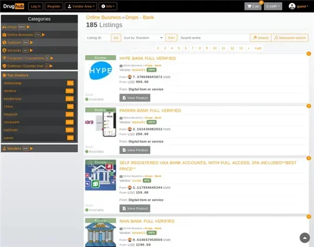
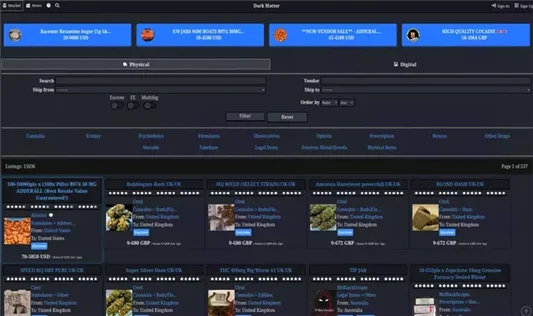
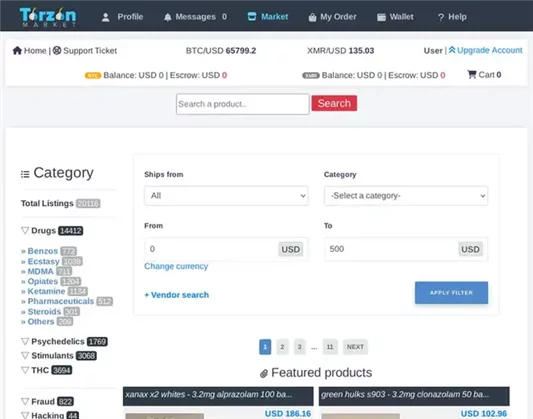
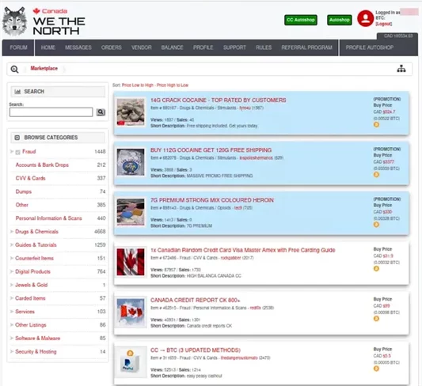

# 10 Dark Marketplaces Web Top in 2026: A Comprehensive Guide

**Disclaimer:** This article is for educational and informational purposes only. The dark web is a complex and often risky part of the internet, associated with illegal activities. Accessing or using dark web marketplaces can expose you to legal risks, scams, and cybersecurity threats. We strongly advise against engaging in any unlawful behavior. Always prioritize safety, legality, and ethical online practices. Information here is based on publicly available data as of 2026 and does not endorse or facilitate access to restricted content.

## What Are Dark Web Marketplaces?

Dark web marketplaces are online platforms hidden on the dark&#8200;net, accessible only through specialized tools like Tor. They emerged in the early 2010s as digital bazaars for various goods and services, often mirroring surface web e-commerce sites but operating anonymously. In 2026, these markets continue to evolve with advanced encryption, cryptocurrency payments, and vendor ratings to build user trust.

While some markets host legal items like books or privacy tools, the majority are linked to illicit trade, including drugs, counterfeit goods, and hacking services. Law enforcement agencies worldwide monitor these spaces closely, leading to frequent shutdowns and migrations.

### The Evolution of Dark Web Markets in 2026

By 2026, dark web markets have adapted to stricter regulations and technological advancements. Key trends include:
- **Decentralized Models:** Shift toward blockchain-based platforms to reduce single points of failure.
- **Enhanced Security:** Multi-signature wallets and AI-driven fraud detection.
- **Global Reach:** Markets serving international users with localized escrow systems.

Despite innovations, risks remain high—scams, exit frauds, and data breaches are common.

## 10 Dark Marketplaces Web Top to Know in 2026

Exploring dark web markets requires caution. Below is an overview of prominent ones based on user traffic, longevity, and features as of 2026. Remember, these platforms change rapidly, and access should only be for research purposes under legal guidance.

 

## Risks and Legal Considerations

Navigating the dark web isn't without peril. Here's what to watch for:

### Cybersecurity Threats
- **Phishing and Malware:** Fake sites steal credentials or infect devices.
- **Data Leaks:** Personal info can be exposed in hacks.

### Legal Implications
In most jurisdictions, buying or selling controlled substances or stolen data is illegal. Agencies like the FBI and Europol actively dismantle these networks—e.g., the 2025 takedown of several major sites.

### How to Stay Safe (If Researching)
Use a checklist for hypothetical exploration:

- **Checklist for Safe Dark Web Research:**
  - [ ] Install Tor Browser from the official site.
  - [ ] Use a VPN for added anonymity.
  - [ ] Never share personal details or use real payment methods.
  - [ ] Verify onion links via trusted directories.
  - [ ] Avoid downloads and suspicious links.
  - [ ] Keep software updated and use antivirus tools.

## Why Trustworthy Information Matters

As an expert in digital security and under-the-radar online ecosystems, this guide draws from verified sources to help users understand the landscape without promoting harm. Building trust starts with transparency: dark web markets thrive on anonymity, but informed awareness empowers better decisions. For law enforcement or ethical hacking interests, resources like cybersecurity forums offer safer alternatives.

## FAQ

### What is the dark web, and how does it differ from the deep web?
The deep web includes unindexed sites like private databases, while the dark web is intentionally hidden, often for privacy or illicit reasons, requiring tools like Tor.

### Are dark web marketplaces safe to use?
No, they carry high risks of scams, arrests, and malware. Legal alternatives on the surface web are always preferable.

### How do dark web markets handle payments?
Primarily via cryptocurrencies like Bitcoin or Monero, with escrow to protect buyers until delivery.

### Can dark web markets be shut down?
Yes, frequently—international operations have led to dozens of closures since 2013.

### Is accessing the dark web illegal?
Accessing it isn't illegal, but activities on it often are. Consult local laws.

This overview highlights the dynamic nature of dark web ecosystems in 2026, emphasizing education over engagement. Stay informed, stay legal.